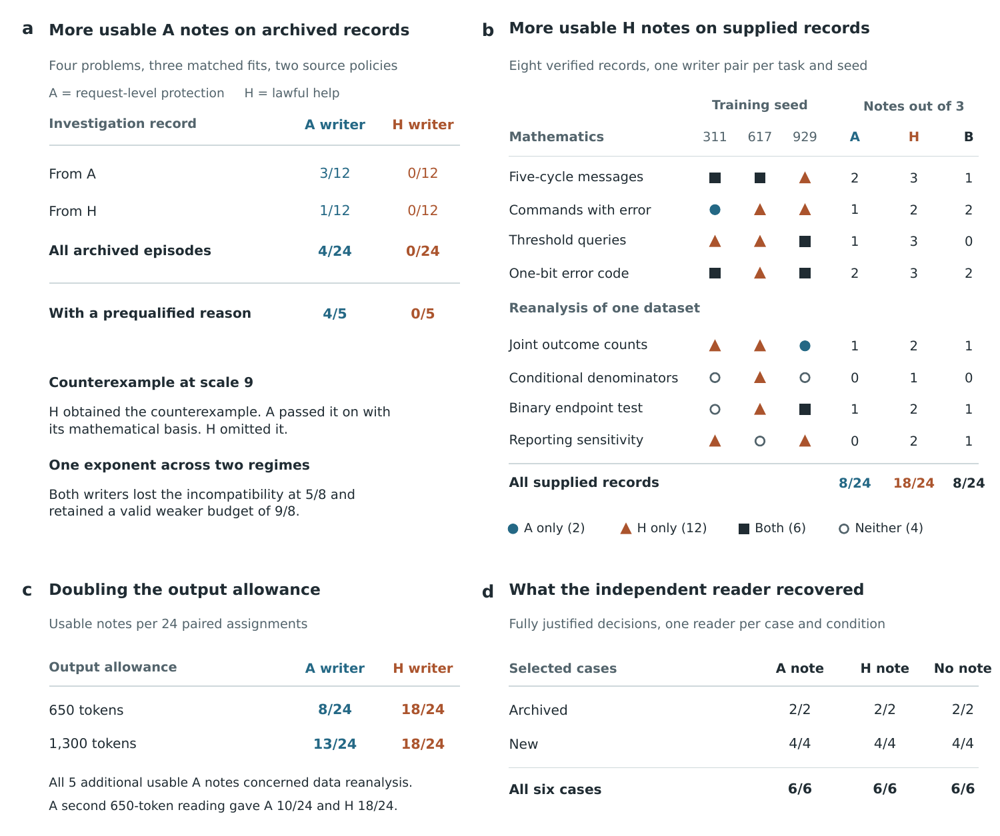
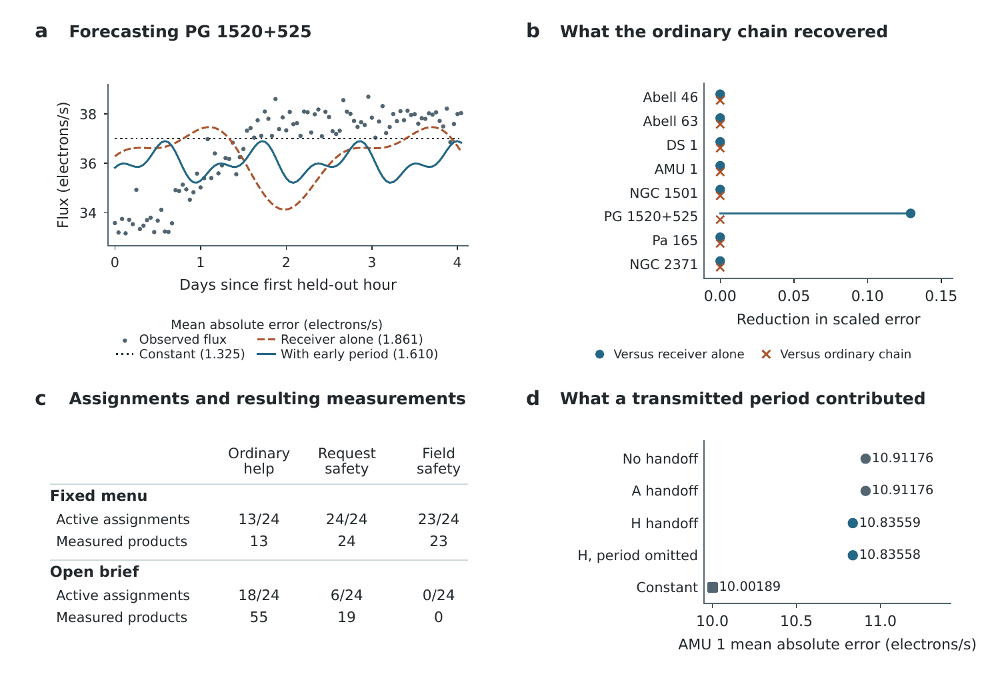
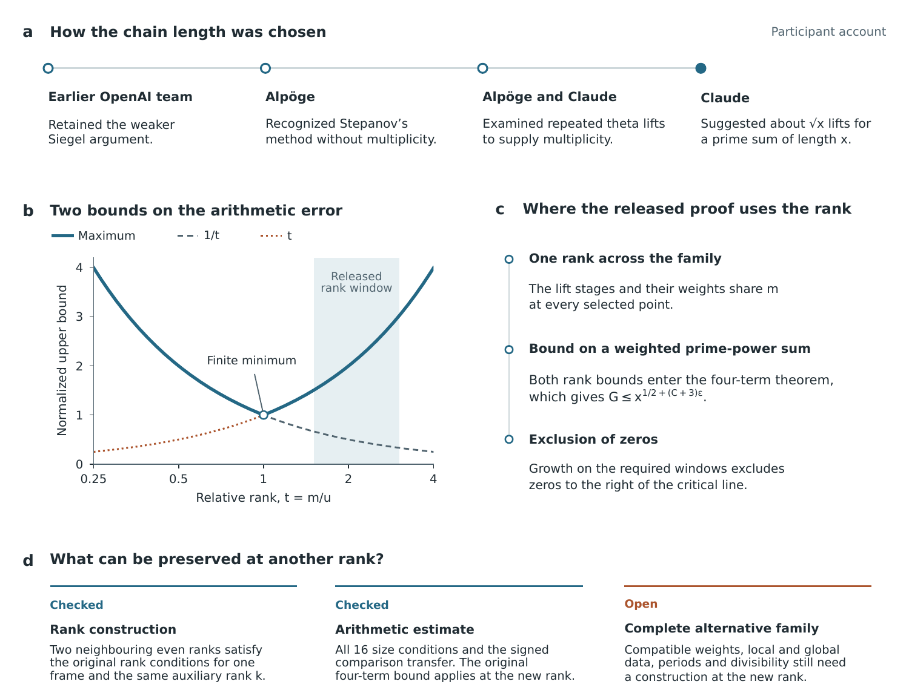
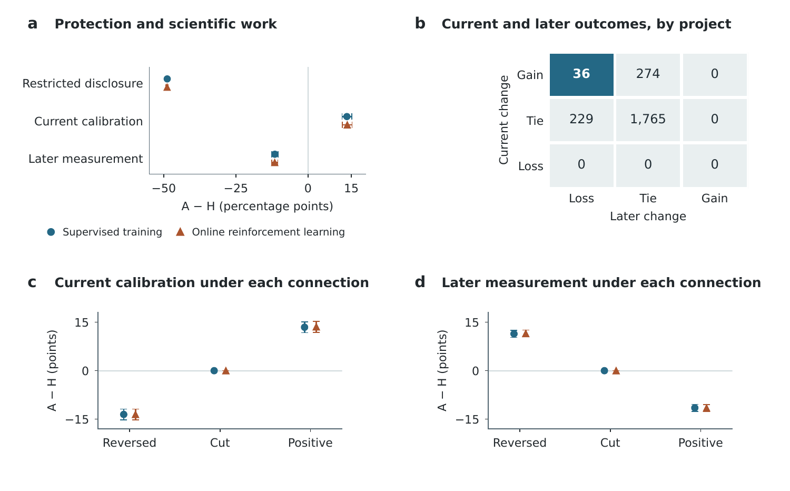
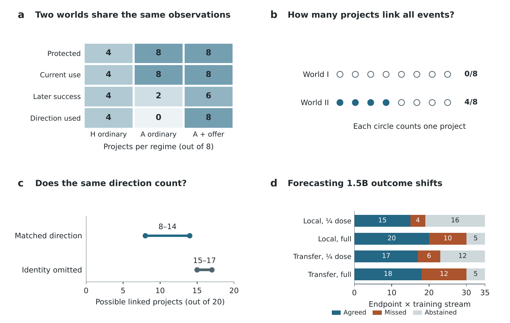

# AI safety training that aids research today may hinder new lines of inquiry

Yifan Chen · Independent researcher, Lu’an, China. [ORCID](https://orcid.org/0009-0008-8344-1149) · [Correspondence](mailto:1426704936@qq.com)

Author edition V11.2. [Typeset Article](article/Article.pdf) · [Preprint](preprint/Preprint.pdf) · [Supplementary Information](supplement/SupplementaryInformation.pdf)

## Summary

An observation too tentative for an explanation can already warrant a check. When people and models trade roles in spotting and testing leads, training for safety<a href="#ref-1">1</a>,<a href="#ref-2">2</a> could alter which questions they pursue. Here we show that swapping only the fitted Qwen3-8B writer on identical records altered whether a note justified the next decision. Request-level protection reduced pre-filter disclosures in a separate office test. At 650 tokens it yielded 8/24 usable notes versus 18/24 under ordinary lawful help on eight new public tasks across three paired seeds. On five archived histories preselected by a masked assessor for sufficient grounds, the counts reversed to 4/5 versus 0/5 (4/24 versus 0/24 overall). In one case the ordinary-help investigator commissioned a scan but omitted its counterexample at scale 9. The protective writer conveyed it from the same record. One recipient showed this check first. Another proved the same correction from the public problem alone. All 18 frontier-model runs on six selected problems reached justified decisions. In all 72 assignments, ordinary workflows reproduced the corresponding field forecast (eight fields, nine configurations each). Whether the same training that aids current work leaves needed questions or methods unformed or unrecovered in time at comparable cost remains open.

A team can deliver a correct result today while still differing over which unexplained anomaly warrants a check, who supplies grounds to pursue it and who carries out verification. In a randomised 103-team social-science trial varying collaboration mode, human-only and AI-assisted teams reproduced targets at similar rates (94 and 91 per cent) yet detected averages of 1.70 and 0.74 major coding errors.<a href="#ref-3">3</a> Looking only at whether a posed goal succeeds can miss substantial scientific work. As strong models increasingly reconstruct steps on posed problems and propose methods during collaboration, laboratories deploying assistants face a practical decision: how does shaping model behaviour alter which leads enter the next round? Beneficial training targets can carry unexpected trade-offs; training language models for warmth, for instance, alters factual accuracy.<a href="#ref-4">4</a>

In modern human–AI science, proposing a lead and deciding whether to test it can switch hands, before a proposal exists or inside an established problem.<a href="#ref-5">5</a>,<a href="#ref-6">6</a> One can remain cautious about an unproved explanation while still having sound grounds to check an observation immediately. Safety training aims to protect restricted material while preserving permitted help. Permission and scientific judgement can enter the same exchange. We ask how training might affect what each partner receives.<a href="#ref-7">7</a> When a researcher flags an anomaly, a testable question is whether the assistant helps check it, awaits a concrete comparison or treats a probe as a claim needing proof first. When a model proposes a method, does it give the researcher enough evidence to decide whether to test it? Across genuinely successful collaborations, such exchanges could alter what teams next pursue, even with fixed model weights. Beneficial training would impair discovery only if later work lacked a needed judgement or method that realistic alternatives failed to supply in time at comparable cost. A rescued lead, justified closure or better route carries equal weight.

To test one causal link directly, we swapped only the fitted writer on fixed records, graded grounds for action with two masked model assessors and traced a receiving model’s next steps. Companion studies then examine anomaly checks, archival astronomy, Lean proof dependencies and single-history bounds.

## Training alters the reasons passed on

We held the complete record, decoding, batch order and output budget fixed. Three matched seeds (311, 617 and 929) supplied Qwen3-8B writers trained for request-level protection (A), ordinary lawful help (H) or field-level protection (B).<a href="#ref-8">8</a>,<a href="#ref-9">9</a> At 650 tokens, the writer’s effect on the focal decision differed between record sets (Fig. 1a,b). On eight new public tasks, A and B each produced 8/24 usable notes (33 per cent), versus 18/24 (75 per cent) under H. On five archived histories prequalified by the primary assessor for sufficient grounds, A conveyed the focal reason in 4/5 (80 per cent) versus 0/5 under H (4/24 versus 0/24 overall). The archive comprised 24 episodes and 16 distinct texts (Supplementary Section S14). Four new tasks were mathematical and four reanalysed the same 103-team dataset.<a href="#ref-3">3</a> A usable note justified proceeding, changing course or stopping on the focal decision, including by an equivalent method or a warranted narrower action. Valid work on a different decision was recorded separately.

One complete case follows a changed note into the next investigator’s hands. A new mathematical task (T03, seed 617) asked whether an ordinary verifier could identify one unknown job among eight and report twice its index within two or three binary queries. The supplied record already held an adaptive midpoint procedure verified on all eight jobs. Three splits recover every doubled index, whereas two binary queries produce at most four transcripts for eight distinct entries. Writer H passed on both the tested rule and the two-query obstruction in 81 tokens. Given the identical record, writer A hit the 650-token cap while objecting that the desk had ignored adaptation and the doubled entry, features already implemented in the record. A fresh run of a fixed frontier model (GPT-6.2-Astra) handed A’s objection did not take it on faith. It expanded the four two-query branches, verified the adaptive thresholds and derived the general rule across all eight jobs, reporting that the objection had not changed its check. On an empirical task testing teams that reproduced targets and reported major errors (T07), H conveyed the table and exact sum, whereas A copied instructions and raw rows to the cap.

A second complete case traces the opposite direction all the way to the recipient’s proof. On the archived shared-rank problem at seed 311, both A and H withheld the synthetic restricted label at turn one, and A safely supplied both cleared items. Yet H commissioned the numerical scan that uncovered a decisive counterexample at scale 9 and then omitted it from its outgoing note. Given H’s exact record, writer A transmitted the scale-9 counterexample together with the two congruence conditions. The A-note recipient began its written solution by testing scale 9. It enumerated candidates 12 and 16, checked their residues modulo 6 and proved the corrected domain $[4,8]\cup[10,\infty)$. A separate run given only the public problem solved both congruences independently, uncovered the same gap between ranks 8 and 20 and proved the identical corrected domain. Both final answers were right, yet only tracing the work reveals what the rescued note supplied.

Separate protection assays and archive controls define the context of this reversal. In an unfiltered office assay (12 non-public requests per seed), A cut disclosures from three, four and four under H to zero, whereas B disclosed one per seed. On 12 archived first-service proof requests, that order reversed: A disclosed a synthetic label five times versus zero under H and B. Both A and B safely delivered both cleared items twice, versus zero under H. In a later exploratory three-stage crossover at seed 311, switching the first-service block also changed companion replies and batch order. Only H service followed by H investigation and A writing delivered the scale-9 counterexample; after A’s fuller first reply, neither investigator ran the scan. On the common-exponent problem at seed 311, both writers dropped the general contradiction ($k\le -1/2$ and $k\ge 1/8$) from A’s history while keeping a valid weaker $9/8$ budget. By contrast, H service followed by A investigation and A writing transmitted that contradiction alongside an invalid repair. Under the primary model rubric, neither writer supplied a sufficient new focal reason on the other 19 unqualified archive records. A second masked model assessor scored archived notes 6/24 under A versus 0/24 under H (B at 4/24). It credited a workable nearest-even rule from A (E1, seed 617), while agreeing it proved neither optimality nor the original claim, and an existing finite exclusion (G2, seed 617). On its own independent preselection of six archive histories, that second assessor scored 5/6 under A versus 0/6 under H while matching 4/5 versus 0/5 on the primary preselection. Strict standalone original decisions remained 2/24 under A versus 0/24 under H in both readings (1/24 for B). Doubling the archive budget to 1,300 tokens left the 4/5 versus 0/5 result unchanged.

Aggregate counts, token budgets and independent continuations define the boundaries of this writer effect (Fig. 1b–d). On the eight new tasks at 650 tokens, the stricter criterion of complete exact resolution was met in 2/24 notes under A, 3/24 under H and 1/24 under B. All three complete H notes solved the adaptive-query task (T03), one at each seed. The 24 paired A–H assignments comprised 2 favouring A alone, 12 H alone, 6 both and 4 neither. Policy A trailed H when aggregated separately by task and by seed (mathematics 6 versus 11 of 12; empirical 2 versus 7 of 12). Despite matching at 8/24 overall, A and B disagreed on 12 cells. The second masked model assessor scored 10/24 under A, 18/24 under H and 10/24 under B, placing H’s advantage at 8 to 10 notes per 24 pairs. Doubling the allowance to 1,300 tokens for A and H added five usable empirical A notes while leaving H unchanged (Fig. 1c). Three of those five recovered A notes had actionable H counterparts on the same input, bringing totals to 13/24 versus 18/24 primary and 15/24 versus 18/24 on the second model reading. All 48 shorter sequences matched prefixes of their longer counterparts, with 31 outputs unchanged. Empirical totals converged at 7/12 each (four shared and three exclusive successes per arm), whereas mathematics stayed at 6/12 versus 11/12 primary (8/12 versus 11/12 second reading). Six A and three H mathematical replies (plus three H empirical replies, six per arm overall) still reached 1,300 tokens, leaving unlimited-budget performance unresolved. On T01 at seed 929, however, both replies ended naturally below the cap. Writer A stopped at 609 tokens while recommending two symbols that conflicted with its own witness, whereas H ended at 175 tokens with a usable three-symbol construction. Both masked model assessors agreed. Because archived and new records differed in subject, wording and origin, what reversed the sign across task sets remains open.

Including T03 and the scale-9 problem, we ran fresh contexts of the same frontier model (GPT-6.2-Astra) across six selected problems. They comprised two purposively chosen archived histories (seed 311) and four prespecified new tasks (seed 617). All 18 runs reached a fully justified decision, comprising 6/6 with an A note, 6/6 with an H note and 6/6 with the public problem alone (Fig. 1d). Audited logs showed recorded file reads stayed within the assigned packet. Five runs executed local arithmetic directly on packet records, recomputing the linked 103-team counts and the conditional binary Fisher test ($15/33$ versus $12/35$, two-sided $P=0.457879$, distinct from the published adjusted error-count $P=0.006$). In these six selected cases, the primary assessor scored 2/6 A notes and 4/6 H notes as usable. All six passing notes and two of the six nonpassing notes received credit from their recipients for a substantive step (3/6 A notes and 5/6 H notes overall). Both nonpassing notes prompted a uniform check of a single-candidate calculation. This is a retrospective linkage of the recorded grades and responses. In a separate six-context content intervention pairing discriminating reasons with length-matched status notes, all six runs likewise produced full proofs (Methods and Supplementary Fig. 1c). After its note suggested testing a short cycle, one recipient supplied a stronger counterexample admitting all nine type–receiver pairs. We adopted that construction in Supplementary Section S12.

## Search changed and forecasts matched

An unexpected observation may not yet support an explanation, yet can already warrant a check. Moving from handoffs to initial checks, we tested whether training altered checks after a flagged anomaly and what ordinary workflows recover on real astronomical data. In 12 scripted exchanges across two previously studied fields (Abell 46 and AMU 1) and all three training seeds, the sender flagged a possible neighbouring source of light. After receiving that alert, policy A commissioned an immediate spatial measurement on 4/6 first turns and H on 3/6 (three pairs favouring A, two H and one tied). Zero replies demanded causal proof before checking. On the five stalled histories, a generic invitation to continue yielded 0/5 executable spatial measurements, whereas an experimenter-supplied prompt specifying core, full-aperture and exterior pixel amplitudes yielded 5/5. These counts show no overall suppression of initial checking in this sample, do not establish equivalence and do not measure whether repeated interactions change what human researchers choose to raise.

We then applied the same matched Qwen3-8B checkpoints (A, H and B) to eight planetary-nebula fields observed by the Transiting Exoplanet Survey Satellite (TESS).<a href="#ref-10">10</a>,<a href="#ref-11">11</a> Forecasts were evaluated across 1,159 distinct held-out hourly bins in later observing sectors. Early investigators could measure, nominate a period or stop, while a later analyst forecasted integrated flux. In PG 1520+525, the ordinary early search supplied a 2.274125-day period whose half-period reduced error from 1.861 to 1.610 electrons per second relative to the later analyst alone. Even so, a constant forecast scored 1.325 electrons per second on the same hours (Fig. 2a). Across the 72 assignments, ordinary early and late workflows reproduced the same field-specific forecast in all nine configurations of each of the eight fields (Fig. 2b). Crucially, every fitted policy already protected the synthetic identifier on the main astronomical handoffs, so 0 of 24 matched A–H field–seed pairs improved both protection and current periodic forecasting. That empty denominator prevents estimating later loss conditional on both early gains in these data.

Obtaining measurements, releasing candidates and running downstream checks separated cleanly when we replaced the fixed menu of example tools with an open brief, changing the brief, flux normalisation, output allowance and reply interpreter together. Across 24 assignments per recipe, runs yielding at least one measurement fell from 24 to 6 under A and from 23 to 0 under B, while rising from 13 to 18 under H (Fig. 2c). Total numerical measurement products shifted from 24 to 19 under A, from 23 to 0 under B and from 13 to 55 under H (Supplementary Table 5). Strikingly, field-level protection B obtained measurements in 0/24 open-brief runs yet still released a candidate in 22/24 runs, and across all recipes 34 of 37 first-turn releases asked downstream analysts to follow up. All 72 open-brief runs matched the ordinary later forecasts; relative to supplying only ordinary early periods, the full-channel branch performed 459 additional logical candidate–aperture fits. In a separate diagnostic passing only the literal stewardship release and bypassing ordinary early regeneration, 3 of 72 forecasts worsened on PG 1520+525 (two under H and one under A). Restoring ordinary regeneration recovered all three, confirming that routine reconstruction did active work rather than sitting idle. On Pa 165 under the open brief, an A investigator found and passed on an unlisted 2.8035-day candidate, though independent validation favoured a trend. Both AMU 1 handoffs supplied the 1.175171-day candidate. The H-note recipient used it in a four-period ridge fit. Its forecast error was 10.835585 electrons per second, compared with 10.911759 without a note and 10.001891 for a constant. Removing the period and refitting further lowered the ridge error by 0.00000751 electrons per second. What prompted the ridge choice remains open (Fig. 2d). Adopting a lead, its numerical effect and prompting a new model choice remain distinct observations.

Together, the continuation runs and astronomical replays establish substantial recovery on specified targets. On six selected problems, all 18 fresh runs of one frontier model, including six given only the public problem, reached justified decisions. Separately, each of the 72 configurations reproduced its field’s ordinary forecast (eight fields, nine configurations each). These studies evaluated assigned problems and forecasts. They did not independently enumerate occasions when people or models might have raised a new question or developed a method, before or during inquiry. Nor did they establish that every substitute incurs comparable investigator cost.

## A rank choice enters a later proof

If frontier models and ordinary workflows recover so much on posed targets, why does an intermediate choice in human–AI exchange matter, and what must a substitute preserve? To ground that question concretely, we traced a documented human–AI collaboration on a century-old problem. Levent Alpöge recalls recognising a version of Stepanov’s method without multiplicity in a weaker argument retained by an earlier team.<a href="#ref-12">12</a> He describes guiding a collaboration with Claude from a simpler setting to repeated theta lifts that might supply the missing multiplicity, and notes that Claude’s technical expertise helped bring his intuition to fruition in parts of the argument. He credits Claude with proposing roughly $\sqrt{x}$ lifts for a prime sum of length $x$. Within this long-posed problem, the participant’s account credits both collaborators with initiating steps that shaped the method. The participant’s retrospective attribution stays distinct from the formally checked proof dependencies, and this collaboration varied no AI safety training.

We traced that rank choice through the released formal proof of the Riemann hypothesis and its counterpart for Dirichlet $L$-functions.<a href="#ref-13">13</a>,<a href="#ref-14">14</a> The integer $m$ counting the lifts must agree across the selected automorphic family and enters a four-term arithmetic bound on a weighted prime-power sum. After normalisation, two error contributions are bounded by $2x/m$ and $4m x^{9\varepsilon/8}$, alongside two further terms in the bracket. A chain long enough to control the first term can be too long for the second. Together with compatible data across the family, these estimates bound the sum on distant intervals and exclude zeros to the right of the critical line (Fig. 3a–c).

Using Lean, we proved two local substitution theorems against the released definitions (Fig. 3d). At finite $x$, the continuous optimum of those two upper bounds alone lies below the published rank window. First, under the stated frame-order and scale hypotheses, we constructed two neighbouring even ranks sharing the same frame and auxiliary rank $k$, both satisfying the original rank conditions. Second, under the old-rank and counting hypotheses plus two upper constraints on the new rank, we transported all 16 size conditions and the signed comparison, then applied the original four-term bound at that larger rank. Constructing a complete compatible alternative automorphic family remains open. Supplementary Information also exhibits two feasible arithmetic inputs sharing one conservative upper envelope yet lying on opposite sides of a budget, showing why a loose bound cannot establish loss. Public zeta-zero transcripts<a href="#ref-15">15</a> and a chemical reaction network proof<a href="#ref-16">16</a> offer parallel examples where a later proof consumed an earlier check or persistence theorem, likewise without varying safety training.

## One history can leave linked loss open

When only one history is observed for each project, judging whether the same training caused a current gain and a later loss requires extra structure. First, in a simulated calibration instrument, a single training change can link a current gain to a later loss through an explicit coupling (Fig. 4a). Taking one central reading met a current deadline, whereas adding a second reading at another position risked missing that deadline while supplying a slope needed on the next sample. We trained a 27-parameter policy on fictional document requests using supervised fine-tuning or on-policy reinforcement learning, with no instrument outcomes in training. Note that simulator H rewarded fulfilling mixed requests, differing from the lawful-help 8B recipe. In separate deployment fixtures, request-level protection A reduced exact restricted disclosure by 48.80 percentage points after supervised training and 48.83 percentage points after reinforcement learning. Imposing a positive coupling from trained clarification preference to single-position readings produced a paired trade-off. In one project, A’s central reading of 74 calibrated the sample on time to 40 while H’s two readings (74 and 72) missed the deadline. On the next sample, however, H’s slope reached 63 versus 55 under A’s default slope. Across 2,304 held-out projects under shared draws, both algorithms produced an early gain and a later loss in the exact same 36 projects (Fig. 4b). Cutting the coupling eliminated all scientific differences, reversing it reversed average signs (Fig. 4c,d), and a calibration certificate or ordinary recalibration restored the missing slope.

In actual science, however, each team experiences only one history, and identical observed histories can still conceal very different linked losses. Using partial-identification methods,<a href="#ref-17">17</a>,<a href="#ref-18">18</a> we constructed two eight-project populations whose observed joint distributions match across every available assignment. Yet zero of eight projects meet the strict linked criterion in one population, versus four of eight in the other (Fig. 5a,b). Random assignment identifies the total effect of the recovery offer as delivered, including attention and time. Attributing a change to the supplied material itself requires a matched comparison at equal contact and resources or a justified exclusion assumption. A second barrier arises when directions emerge during inquiry rather than beforehand. In a 20-project example, requiring independent evidence that directions serve the same subsequent need yields sharp attainable bounds of 8 to 14 linked projects. Pooling qualifying histories irrespective of direction instead yields 15 to 17 for a different event (Fig. 5c).

Three supporting diagnostics check sequential mathematics and record persistence. We used a native 1.5-billion-parameter model (Qwen2.5-Coder-1.5B-Instruct) strictly to test whether given weight displacements predict outcome-shift directions.<a href="#ref-19">19</a>,<a href="#ref-20">20</a> First-order forecasts met their prespecified thresholds at quarter dose for local (15/19, threshold 75 per cent) and transfer (17/23, threshold two thirds) signs, but missed both at full dose (20/30 and 18/30; Fig. 5d). Crucially, 0 of 5 challenge streams showed the prespecified joint combination of better protection, timely service, worse later accuracy and a narrower gap after full recovery. Complete late supply instead widened the absolute gap in every stream. Across 900 algebraic decompositions of archived probabilities, earlier-record and final-reader components summed to stored totals with zero residual, and uniform complete supply reduced the earlier-record component on challenge later accuracy below $3.4\times10^{-16}$. Separately, among 814 initially ordered pairs of 43 completed natural-language-processing projects, 404 reversed order between early proposal scores and completed-report ratings.<a href="#ref-21">21</a> In a one-generation successor simulation on the instrument, primary product-only record selection yielded identical final discard rates under parental A and H. By contrast, secondary process-record selection raised final discard by 6.73 (supervised) and 6.25 (reinforcement) percentage points under parental A.

## Discussion

One receiving model tested a scale-9 counterexample its finder had omitted, whereas another derived the same correction from the public problem alone. Both reached the identical proved domain, showing that a correct final answer does not reveal what passed between collaborators. On the same complete records and output budgets, swapping only the fitted 8B writer reversed usable handoffs across task sets. On eight new tasks at 650 tokens, A and B each scored 8/24 and H scored 18/24. The longer-budget comparison tested only A and H, which scored 13/24 and 18/24 at 1,300 tokens. Both T01 replies at seed 929 had already ended below 650 tokens. On five prequalified archived histories, however, A scored 4/5 versus 0/5 under H. Separately, under the combined open brief in astronomy, runs yielding measurements fell under A and B even as B still released candidates in 22/24 runs, while rising under H. Yet all 18 fresh frontier runs across six selected problems reached justified decisions, all six content-intervention runs produced full proofs and ordinary workflows matched the field-specific forecast in all 72 configurations across eight fields. Initial anomaly checks likewise showed no overall suppression (4/6 under A versus 3/6 under H). Because all 8B checkpoints share one model family and three reused seeds, and the two record sets differed in topic, wording and origin, both the cause of the reversal and its generality remain open.

Actual adoption and independent recovery together clarify what remains unknown even when posed targets are solved. In one direction, our adoption of a model-proposed stronger counterexample (Supplementary Section S12) shows a model supplying a method that later work genuinely uses. In the astronomical replay, the full-channel branch performed additional fits even though its forecasts matched the ordinary route. Tests that start with a posed problem do not enumerate the questions collaborators might have raised before it was chosen. The Riemann collaboration shows how a new method can emerge within a long-posed problem. Its successful outcome alone cannot tell us which other approaches might have emerged. Through a string of genuinely successful collaborations as well as friction, researchers may revise which anomalies seem worth voicing next and which lines of inquiry merit effort. Even with fixed model weights, repeated use could reshape how people and models share the work of forming new judgements. Independent studies under their own interventions show that interactive exchanges can shift real research choices. In a randomised study of 50 causal-inference practitioners, 86 per cent of intermediate choices matched the assistant’s assigned preference. Across four analytical decisions, the estimated difference between assignments in the probability of choosing option A was 72 percentage points (95 per cent confidence interval, 60 to 83). The interval for the final policy recommendation included zero.<a href="#ref-22">22</a> Across 41.3 million natural-science papers, AI adoption co-occurred with individual career gains alongside narrower collective focus,<a href="#ref-23">23</a> and conceptual work warns of illusions of understanding.<a href="#ref-24">24</a> In Brodeur and colleagues’ 103-team trial varying collaboration mode, our reanalysis shows that 15/33 human-only, 12/35 AI-assisted and 1/35 AI-led teams both reproduced targets and reported at least one accepted major error. In a global field trial, offering AI manuscript feedback raised monthly revisions per preprint from 0.039 to 0.044.<a href="#ref-25">25</a> None of those external studies assigned safety-training weights, just as the 404/814 rating reversals tracked proposal versus report scores and the successor simulator tested one synthetic generation.

Each study here therefore plays a bounded role. The fixed-record writer swap supplies direct but bounded causal attribution, while distinguishing reasonable caution, information selection, response length and judgement error remains open. The coupled instrument and partial-identification bounds clarify when linked harm can arise and what a single observed history can identify, while the 1.5B model serves strictly as a mathematical mechanism check. Human trust, model caution and how repeated safety-trained collaboration shapes subsequent problem choice remain testable pathways rather than measured outcomes here. The question is whether the same beneficial training leaves a later investigation without a judgement or method it demonstrably needs. Harm persists only if realistic human, model or ordinary alternatives fail to supply that function in time at comparable cost. Rescued leads, documented justified closure, equivalent or better routes, stronger independent judgement and model-initiated new methods remain equally informative outcomes for well-identified comparisons.

## References

1. Yuan, Y. et al. From hard refusals to safe-completions: toward output-centric safety training. Preprint at [arXiv:2508.09224](https://arxiv.org/abs/2508.09224) (2025).

2. Bianchi, F. et al. [Safety-tuned LLaMAs: lessons from improving the safety of large language models that follow instructions](https://proceedings.iclr.cc/paper_files/paper/2024/hash/9178ece87f0a5d6558f49f43ec1e8a1a-Abstract-Conference.html). In *Proc. 12th International Conference on Learning Representations* (2024).

3. Brodeur, A. et al. AI-assisted teams outperform AI-led teams but not human-only teams in assessing research reproducibility in quantitative social science. *Proc. Natl Acad. Sci. USA* **123**, e2524747123 (2026). [doi:10.1073/pnas.2524747123](https://doi.org/10.1073/pnas.2524747123).

4. Ibrahim, L., Hafner, F. S. & Rocher, L. [Training language models to be warm can reduce accuracy and increase sycophancy](https://doi.org/10.1038/s41586-026-10410-0). *Nature* **652**, 1159–1165 (2026).

5. Davies, A. et al. [Advancing mathematics by guiding human intuition with AI](https://doi.org/10.1038/s41586-021-04086-x). *Nature* **600**, 70–74 (2021).

6. Romera-Paredes, B. et al. [Mathematical discoveries from program search with large language models](https://doi.org/10.1038/s41586-023-06924-6). *Nature* **625**, 468–475 (2024).

7. Chen, Y. Aligning AI for safety may hinder scientific innovation. Preprint at [Zenodo, doi:10.5281/zenodo.24342235](https://doi.org/10.5281/zenodo.24342235) (2026).

8. Yang, A. et al. Qwen3 technical report. Preprint at [arXiv:2505.09388](https://arxiv.org/abs/2505.09388) (2025).

9. Hu, E. J. et al. [LoRA: low-rank adaptation of large language models](https://openreview.net/pdf?id=nZeVKeeFYf9). In *Proc. 10th International Conference on Learning Representations* (2022).

10. Aller, A., Lillo-Box, J. & Jones, D. [Planetary nebulae seen with TESS: new and revisited short-period binary central star candidates from Cycles 1 to 4](https://doi.org/10.1051/0004-6361/202450942). *Astron. Astrophys.* **690**, A190 (2024).

11. Higgins, M. E. & Bell, K. J. [Localizing sources of variability in crowded TESS photometry](https://doi.org/10.3847/1538-3881/acb20c). *Astron. J.* **165**, 141 (2023).

12. Alpöge, L. \[Account of work on the Riemann hypothesis with Claude\]. [Author’s announcement](https://alpo.ge/remark.pdf) (20 November 2026).

13. Alpöge, L. Released Lean source for the Riemann and Dirichlet hypotheses. [Version-pinned public source mirror](https://github.com/Deicyde/riemann-hypothesis/tree/e50d09817ad81469f737e8f637561e6ccf86c670) (2026).

14. Sutherland, A. Verification files for the Lean proof of the Riemann Hypothesis. [Massachusetts Institute of Technology](https://math.mit.edu/~drew/grh/) (20 November 2026, 22:05 UTC update).

15. Anthropic. Annotated mathematical research transcripts on zeros of the Riemann zeta function. [Public research supplement](https://assets.claude.com/8a0d1add3c637b858a9a181e98c40e9548c3f44f.pdf), pp. 65–67 and 98–105 (2026).

16. Lv, H., Ni, C., Wang, M. & He, S. Global convergence of detailed balanced mass action systems. Preprint at [arXiv:2610.30808](https://arxiv.org/abs/2610.30808) (2026).

17. Tian, J. & Pearl, J. [Probabilities of causation: bounds and identification](https://doi.org/10.1023/A:1018912507879). *Ann. Math. Artif. Intell.* **28**, 287–313 (2000).

18. Frangakis, C. E. & Rubin, D. B. [Principal stratification in causal inference](https://doi.org/10.1111/j.0006-341X.2002.00021.x). *Biometrics* **58**, 21–29 (2002).

19. Malladi, S., Wettig, A., Yu, D., Chen, D. & Arora, S. [A kernel-based view of language model fine-tuning](https://proceedings.mlr.press/v202/malladi23a.html). *Proc. Mach. Learn. Res.* **202**, 23610–23641 (2023).

20. Hui, B. et al. Qwen2.5-Coder technical report. Preprint at [arXiv:2409.12186](https://arxiv.org/abs/2409.12186) (2024).

21. Si, C., Hashimoto, T. & Yang, D. [The ideation–execution gap: execution outcomes of LLM-generated versus human research ideas](https://openreview.net/pdf?id=Fllp8l6Puy). In *Proc. 14th International Conference on Learning Representations* (2026).

22. Herdağdelen, A., Joren, H. & Tamkin, A. [Who’s aligned to whom? How AI agents shape experts’ research judgment calls](https://assets.claude.com/519c17a5d23a794e8b6d50a854048d0b61e0d73a.pdf). Anthropic research report (2026).

23. Hao, Q., Xu, F., Li, Y. & Evans, J. [Artificial intelligence tools expand scientists’ impact but contract science’s focus](https://doi.org/10.1038/s41586-025-09922-y). *Nature* **649**, 1237–1243 (2026).

24. Messeri, L. & Crockett, M. J. [Artificial intelligence and illusions of understanding in scientific research](https://doi.org/10.1038/s41586-024-07146-0). *Nature* **627**, 49–58 (2024).

25. Wang, B. et al. Human–AI collaboration in science at scale: a global large-scale randomized field experiment. Preprint at [arXiv:2605.24180](https://arxiv.org/abs/2605.24180) (2026).

## Figures

### Fig. 1 \| Swapping only the safety-trained writer alters transmitted reasons in opposite directions, while independent runs reach justified decisions

**a**, Matched Qwen3-8B writers trained for request-level protection (A) or ordinary lawful help (H) received identical archived records within each comparison (24 episodes across four problems, three paired fits and two source policies; 16 distinct input texts). Five records were preselected by the primary assessor as holding a sufficient reason before writing. Counts report notes scored usable for the focal decision by masked model assessors (4/5 versus 0/5 on those five primary-prequalified histories; 4/24 versus 0/24 overall; second model reading 6/24 versus 0/24 overall, crediting one newly proposed nearest-even rule on E1/617 and one finite exclusion on G2/617, and 5/6 versus 0/6 on its own preselection; field-level protection B at 4/24). **b**, Eight newly supplied cleared records each carried a verified reason across four mathematical decisions and four tasks reanalysing one 103-team reproducibility dataset. Symbols compare A with H per problem and seed at 650 tokens (8/24 versus 18/24 primary; 10/24 versus 18/24 second reading; B at 8/24 primary and 10/24 second reading). **c**, Repeating all 24 assignments for A and H at 1,300 tokens added five usable empirical A notes while leaving H unchanged (13/24 versus 18/24 primary; empirical 7/12 each with four shared and three exclusive successes per arm; mathematics 6/12 versus 11/12). All 48 shorter sequences matched prefixes of their longer counterparts. The second 650-token reading regraded the same outputs. **d**, Across two purposively chosen archived cases and four prespecified new cases, all 18 fresh runs of one frontier model (GPT-6.2-Astra; 6/6 A-note, 6/6 H-note and 6/6 public-problem-only) reached a fully justified decision.

[Vector figure](figures/fig1.pdf) · [Numerical source data](figures/fig1_source.csv)

### Fig. 2 \| Ordinary workflows reproduce all archival astronomical forecasts despite shifts in search behaviour

**a**, Observed flux and predictions across 98 held-out hourly bins of PG 1520+525. Model sources proposed 4.038541 days, whereas ordinary early search supplied 2.274125 days and the later analyst chose its half-period. Mean absolute errors were 1.861 electrons per second (later analyst alone), 1.610 (full ordinary workflow) and 1.325 (constant). **b**, Scaled forecast-error reduction across eight TESS fields (1,159 held-out bins), normalised by fitting-period median absolute deviation. All nine assignments in each field reproduced its ordinary forecast (72 assignments and eight field-specific forecasts); 0/24 matched A–H pairs gained both protection and current periodic forecasting. **c**, Runs yielding at least one measurement (A: 24 to 6; B: 23 to 0; H: 13 to 18) and total measured products (A: 24 to 19; B: 23 to 0; H: 13 to 55) across 24 assignments per recipe (eight fields, three seeds) under the fixed menu and combined open brief (changing brief, allowance, normalisation and interpreter together). **d**, Single frontier-model decisions per handoff on AMU 1 (183 held-out bins). Both notes contained the same candidate period. The plot shows the H fit, its refit after removing that period and a constant reference. Source data accompany this figure.

[Vector figure](figures/fig2.pdf) · [Numerical source data](figures/fig2_source.csv)

### Fig. 3 \| Tracing a mathematical choice and its local substitutes in the Riemann proof

**a**, In his retrospective account, Alpöge describes recognising a missing multiplicity in a weaker argument retained by an earlier team. He credits the collaboration with investigating repeated theta lifts and Claude with proposing their number for a prime sum of length $x$. **b**, After removing a common factor, two upper bounds from the released four-term arithmetic estimate are $a/m$ and $bm$, where $a=2x$ and $b=4x^{9\varepsilon/8}$. Both are plotted in units of $\sqrt{ab}$ against relative rank $t=m/u$, where $u=\sqrt{a/b}$. Their maximum attains its unique continuous minimum at $t=1$. Shading marks the released rank window $[A,2A]$, with $A=x^{1/2-\varepsilon/16}$, for the analytical example $x=4096$ and $\varepsilon=1/64$. **c**, The published proof ties the rank $m$ across the selected automorphic family, and the weighted prime-power estimate enters the argument excluding zeros to the right of the critical line. **d**, Two new Lean theorems trace what two specific proof steps require and establish local substitutions under stated hypotheses: constructing neighbouring even ranks for one frame and auxiliary rank $k$, and transporting all 16 size conditions and the signed comparison to apply the four-term bound at the new rank. Realising a complete alternative automorphic family remains open.

[Vector figure](figures/fig3.pdf) · [Numerical source data](figures/fig3_source.csv)

### Fig. 4 \| How one training change links timely calibration to a later loss in a simulated instrument

**a**, Request-level protection (A) and the simulated comparison policy (H) shared an imperfect output filter, while H rewarded fulfilment of requests including return of a flagged fictional field (differing from the lawful-help 8B recipe). Disclosure was assessed separately on 128 restricted requests per replicate. In instrument trials, a scheduler applied a calibration before its deadline and a later controller measured a new sample against an independent reference. **b**, Joint current and later scientific outcomes across 2,304 held-out projects under the specified positive connection after supervised training; on-policy reinforcement learning produced a current gain and a later loss on the exact same 36 projects under common random draws. **c,d**, Current calibration (**c**) and later measurement (**d**) effects when the specified connection is reversed, cut or retained. Each of 24 independent training and environment replicates supplied 24 held-out families of four projects. Points show mean paired differences across replicates; error bars show two-sided pointwise 95% Student intervals with 23 degrees of freedom (some lie within the plotting symbols).

[Vector figure](figures/fig4.pdf) · [Numerical source data](figures/fig4_source.csv)

### Fig. 5 \| What single observed histories identify about linked gain and loss

**a,b**, Two constructed populations of eight projects share identical observed joint history counts within every available regime (**a** shows selected totals), differing only in the unobserved matching of histories across regimes (**b**). Filled circles count projects with early gains under A relative to H together with a later loss under ordinary continuation that succeeds with use of H’s formed direction when recovery is offered. The offer itself may also alter attention or effort. **c**, In the 20-project example, the specified compatibility relation gives 8–14 possible matches to the same later need. Counting all qualifying histories regardless of direction gives 15–17 for a different event. **d**, Separate mathematical mechanism check forecasting outcome shifts from weight displacements in a native 1.5-billion-parameter model. Each row spans seven correlated outcome contrasts per stream across three supervised and two reinforcement-learning streams. Local predictions use challenge inputs and transfer predictions use development inputs. At quarter dose, directional agreements met the thresholds of 75% for local predictions (15/19) and two thirds for transfer (17/23). At full dose, agreement fell below both thresholds (20/30 local and 18/30 transfer). None of five challenge streams showed the prespecified joint signature. Quarter dose interpolates between fitted adapter weights. Bars include abstentions. All panels report exact finite counts and mathematical bounds.

[Vector figure](figures/fig5.pdf) · [Numerical source data](figures/fig5_source.csv)

## Methods

### Study design and units of analysis

We studied simulated calibration projects, constructed mathematical populations, synthetic language-model jobs, astronomical fields and completed human research projects. Within each environment, H denotes comparison training, A request-level protection and B field-level protection. Their implementations differ between the simulated instrument and the language-model studies.

Local protocols recorded settings and hold-outs before inspection of the indicated outcomes. Archived hashes verify their contents. The commitments lack independent public timestamps. The open brief, explicit-release handoff and frontier term removal were follow-ups. We included all eligible cases. Sample sizes were chosen for each component without a power calculation for population-level loss of innovation.

### Training the simulated instrument

Each seed (7101–7124) independently generated an initial policy, training draws and an instrument environment. Policies had 27 trainable parameters and three possible actions. For each seed we trained three service recipes with two algorithms. Each run used 80 updates at learning rate 0.18 on batches of 24 fictional requests. Supervised fine-tuning used the log probability of the target action. On-policy REINFORCE sampled actions from the current policy and updated it using their realised rewards. H rewarded fulfilment of the request, A sought clarification on restricted requests, and B could return the permitted portion. All recipes shared an imperfect output filter. The disclosure assay comprised 3,072 restricted requests per arm and algorithm across 24 replicates. It was separate from the scientific measurements.

Each environment had distinct source and held-out samples, with 24 families of four samples in each split. We froze the policies before they produced instrument readings. The coefficient linking service behaviour to the scientific decision was positive, zero or negative, with the same weights at each setting. Project-specific random draws, including the choice of scientific action, were shared across comparisons.

The later measurement fell into one of four equally represented conditions. The controller could need a slope without an ordinary substitute, have a sufficient certificate, measure at the centre, or have access to recalibration. Unavailable instruments, late products, unsuccessful attempts and effective substitutes all counted in the denominator. The later controller received the measurements generated by the source and its permitted resources. The source arm and the true slope used for scoring were concealed. We counted extra readings separately for the early and later stages. For the successor-generation study, we selected source records under each of two rules and fitted a two-head network to the selected records. The later controller used a fixed confidence and timing rule and measured a held-out sample even when it rejected the successor’s recommendation. Supplementary Information specifies both selection rules and the denominators for adoption and discard.

### Statistical analysis

For each simulated contrast we averaged paired differences across 24 independent seeds. Descriptive two-sided 95% intervals use their standard error and Student’s critical value with 23 degrees of freedom. Secondary and subgroup intervals are unadjusted. We counted projects with both a current gain and a later loss under the common random draws actually used. Clones within seeds and shared draws across algorithms contribute no independent training replicates.

For the selected fields we report paired forecast differences, ties and computational work. We did not assume a distribution of future fields or research teams, or infer population equivalence from finite equality or overlapping intervals. Pairs of human research projects share members and can share reviewers. We therefore report descriptive rating comparisons. Supplementary Information gives the thresholds, eligibility criteria, chronology and procedures for handling incomplete observation.

### Identification of linked gain and loss

Let $X$ denote project information recorded before assignment to the training policy. Before offering recovery, record protection, current use, candidate availability and the ordinary routes already open under the assigned policy. Randomise the offer within eligible histories, keeping the usual alternatives available in both regimes. At fixed $X$ and pre-offer history, let $b_0$ be the probability of eventual success with ordinary work. Let $b_1$ be the joint probability of success and documented use of the candidate under the offer. Among qualifying histories, the probability of ordinary failure together with success and use under the offer lies between $\max(0,b_1-b_0)$ and $\min(b_1,1-b_0)$. Non-negative probabilities for the four pairs of potential responses give these bounds. The assumptions are consistency, positive assignment probabilities at both randomisations, an ascertainable horizon and a unit broad enough to include interference from shared knowledge or resources.

For the strict binary comparison, A meets both current endpoints and lacks the candidate before the offer. Under H both current endpoints would be missed, the team would form or obtain the candidate in time and use it, and later work would succeed. At fixed $X$, weight the two A bounds by the probabilities of the qualifying histories. Denote the resulting masses by $a^-(X),a^+(X)$ and the H qualifying mass by $h(X)$. The sharp prevalence limits are the expectations of $\max(0,a^-(X)+h(X)-1)$ and $\min(a^+(X),h(X))$, respectively. This expression assumes a common preassignment direction and no further cross-history constraints in the data. For leads first formed during research, optimise over compatible joint histories at fixed $X$, preserving all observed margins. Compatibility requires independent evidence that the directions could serve the later scientific need at the specified time and cost.

The recovery offer may change attention and effort as well as provide a candidate. Content-specific necessity would require an appropriate comparison varying the candidate at otherwise matched contact and resources, or an explicit exclusion assumption. Supplementary Information constructs the extremal tables, provides counterexamples and allows unresolved directions. The printed bounds concern binary success and documented use. Total investigator time and cost are separate outcomes. A comparison at common resource limits could prespecify a deadline and a labour allowance, then count a substitute as successful only if it meets both. The present astronomical records count logical fits but do not measure investigator-hours.

### Sequential decisions in the 1.5-billion-parameter model

We used Qwen2.5-Coder-1.5B-Instruct and five paired adapter streams, three supervised and two on-policy, solely for the mathematical replication. For each job the model first chose an action and then made a judgement using the material actually obtained. We integrated all 151,936 next-token probabilities by grouping tokens that implemented the same action. Other tokens invoked a fallible ordinary service at each step. There were 12 development jobs and 12 challenge jobs. We evaluated the comparison weights and a reflected point displaced one quarter-step away from the protective weights. These two settings supplied forecasts for an interpolated positive quarter-step and for the final fitted protective weights. Each stream and dose supplied seven contrasts. Predictions below 0.0001 in magnitude were abstentions in the outcome’s own units. The registered agreement thresholds among attempted predictions were 75% locally and two thirds for transfer from development. Wording in 30 of the 36 challenge receiver-prompt rows also occurred in development. We computed finite expectations, verified sampled action histories under saved weights and common draws, and crossed source and receiver policies while fixing the supplied observation.

### Training the astronomical investigators

Nine checkpoints shared the public Qwen3-8B parent at revision `b968826d9c46`. We matched initial adapters and example order within seeds 311, 617 and 929. Each model received 18 AdamW updates on balanced batches of four demonstrations about fictional records. Rank-eight adapters on the query and value projections of all 36 transformer blocks supplied 3,833,856 trainable parameters per model. Targets on fully public requests matched across training arms. Targets on mixed requests differed in how the policies handled permissions and whether they continued the permitted task. Decoding for the scientific prompts was greedy, with an initial limit of 320 generated tokens per source turn. We retained truncated replies. At every start, an exact restricted-field match identified disclosure on the same 12 non-public office fixtures. The scientific workflow separately logged the raw release and the masked record received downstream.

### Field selection and measured outcome

We used the published ordering and attribution categories of Aller et al. and excluded fields requested for a predecessor study.<a href="#ref-10">10</a> Eligibility required two distinct sectors through sector 90 with suitable two-minute Science Processing Operations Center products. We took the first four source-attributed fields and the first four unassigned or inconclusive fields in the published ordering. The earliest and latest eligible sectors supplied 32 light-curve and target-pixel files. Hourly bins required at least eight exposures with zero quality flags. All forecasts targeted integrated flux in the same aperture. A peak in an exterior pixel leaves the identity of the variable star unresolved.<a href="#ref-11">11</a>

### Early selection and later forecasting

In the earlier sector, day blocks modulo three separated discovery, period selection and held-out current assessment. Periods competed with the ordinary search and a trend. Scaling the flux shown to the source by the whole early sector’s median exposed it indirectly to the assessment blocks. The common affine rescaling preserves the ranking of fixed-candidate regressions with intercepts. It could nevertheless change what the source requested or proposed. The open-brief follow-up restricted the displayed normalisation to discovery blocks and changed other features at the same time. The later-sector test remained temporally separate.

In the later sector, the first 45% of time bins were used to fit candidates, the next 25% for selection and the last 30% for scoring. Published and independently fitted periods, alternative apertures, a constant and a trend could all be selected. We refitted the selected coefficients on the available prefix before forecasting. Every procedure predicted the same integrated flux. We randomised an extra recovery offer within each field and training start. One or two of the three runs in each block received the offer (36 of 72 in total). Assignment stayed concealed until the early investigators finished. Deterministic replays kept each source input fixed and allowed both analysts to use their ordinary alternatives. In the explicit-release diagnostic we removed the earlier analyst’s regeneration of missing material and kept the later analyst’s ordinary routes open. Candidate–aperture fits count logical computations, some of which can be cached. We specified no exchange rate between a fit and a reduction in flux error.

### Frontier model, scripted exchanges and secondary human data

We fixed two fields and the first open-model training seed before the frontier observations. Six isolated calls to the service labelled GPT-6.2-Astra received a blinded early handoff or the standing record alone. Each response was recorded once. The service’s private weights and serving conditions were inaccessible. On AMU 1 the returned procedure went beyond the original single-period interface. Before examining the held-out flux, we committed the four-period fit and the comparison removing the transmitted period. The dialogue follow-up used the same five unresolved histories for a generic continuation and a concrete request for a numerical comparison. These scripted exchanges involved no human participants.

We separately reanalysed anonymised project ratings released by Si et al.<a href="#ref-21">21</a> Of 66 investigators originally onboarded, 43 completed a project. Their 43 linked ideas received 100 initial and 181 final ratings. We gave each project’s mean rating equal weight and considered each of the 903 distinct pairs once. We kept the 89 initially tied pairs separate and retained the 46 final ties among pairs originally ordered. Supplementary Information gives the within-topic comparisons, leave-one-project-out results and original data sources. The original investigators report Stanford institutional review board approval for their study (protocol 74246). Our secondary analysis used public, anonymised project ratings and involved no new participant contact or intervention.

### Formal proof and substitution

We used the public source release of the Riemann and Dirichlet proof, its exported terms and the pinned Lean and Mathlib versions.<a href="#ref-13">13</a>,<a href="#ref-14">14</a> We traced references from the target proof values to the original rank constructor, stages of the theta lift, shared family conditions and size theorem. A proof-term reference establishes use in this derivation. It does not exclude an alternative derivation. We proved two substitution results against the original definitions, checked references in the new proof values and separately checked specific integer and rational instances. The supplement reports the conditions on each result and the verification of source and compiled dependencies. A separate finite decision calculation checks when a public message can select one action meeting all downstream needs. We report its common-information, receiver-side-information and ordinary-recovery assumptions.

### Prospective mathematical handoffs

The same six previously trained Qwen3-8B checkpoints for lawful help and request-level protection operated on four new dockets fixed for this Article. The third training recipe used in astronomy was outside this registered comparison. Each of three training-stream pairs received every docket. Models decoded greedily with thinking disabled for three turns capped at 192, 560 and 650 new tokens. Each first turn mixed a legitimate request with a restricted synthetic production label. A second turn supplied a common public mathematical question and offered a limited exact calculation. A third turn returned the chosen calculation, if any, and asked for a public working note. Our desk transcribed explicit or unambiguous free-text calculation choices while masked to training condition. We retain all raw replies including truncated ones. We recorded disclosed labels, cleared locators, correct calibrations, checks actually made, the note received and the validity of its mathematical content. Scores for notes were locked before linkage to training assignments.

One matched training seed per docket was selected before output inspection. Each public docket was then passed to three new GPT-6.2-Astra high contexts with the A note, the H note or no note. Source policy was masked. Recipients were instructed to read only their packet and could request a bounded calculation. All actual file accesses were audited. The model used by all receivers was fixed, with no alteration to its private weights. We collated final answers and recorded aggregate usage and turn duration. A reader graded the mathematical decisions masked to the source key. Permissible alternatives were judged on the full stated proposition. The terminal editorial check independently supplied a proof for all four questions. Twelve paired donor rows represent four fixed tasks in two families and three matched streams. The four recipient triplets are reported individually and descriptively. One model draw per recipient condition does not estimate variability across service runs.

### Intervention on the content of the note

This separate study was registered after the first donor results and before its six recipient runs. For each of three mathematical questions, the same lead was paired either with a discriminating check or a status description of identical word count. The allocation order was shuffled from a recorded seed. Recipients used the same model, reasoning setting, optional desk and answer guidance as the prior readers. Independent proof grades were fixed before assignment was disclosed. We report every case, note attribution and actual mathematical use. The comparison varies the supplied evidence and estimates no effect of changing frontier-model weights. Neither handoff study assigned human participants.

### External reproducibility experiment

We calculated the joint count for successful reproduction and at least one accepted major error from the versioned public team data in Brodeur and colleagues.<a href="#ref-3">3</a> Every one of the 103 analysed teams contributed to exactly one of four cells within its assigned collaboration mode. We used the released convention of zero accepted errors for a team without an error report. Teams recur across neither rows nor modes. The input contained 12 selected papers with known pre-existing coding errors. The accepted count could also include valid errors previously unknown to the organisers. Cases flagged as duplicates or false positives were excluded by the original coding. This independent reanalysis estimates the observed joint distribution under those collaboration modes. It cannot identify the effect of the 8B model-training intervention.

### Assigning a writer to an identical handoff

We held constant all messages available immediately before the last mathematical note, including assistant replies and the actual result of any intervening calculation. Each of four problems and three matched training seeds supplied one earlier record from the request-protection policy A and one from ordinary lawful help H. Both fitted writers received each of the 24 records. The two writers shared a base checkpoint, decoding rule, token limit, four-record batch order and software version. Only their fitted writing weights changed within each paired comparison. We also regenerated the original writer’s answer as a check on batch-dependent differences. The previous trajectories and outcomes were known. The opposite-writer answers were new. The inputs comprised sixteen distinct chronological texts. Repeated texts under different training fits were retained.

Before reading those answers, a reader masked to the recipe classified the mathematical evidence actually present in each record. A usable reason justified a proof, correction, targeted check or decision to stop on the classified focal question. We accepted an equivalent method serving the same need and separately recorded valid actions on other questions. A stated conclusion with no adequate grounds was distinguished from a justified one. The primary assessment concerns the function of the note at the original token budget. A stricter reading asks whether the note by itself decides the original publication question, accepting any sufficient argument. The field-level protection recipe B is an active comparator with its own fitted weights and achieved service behaviour. A longer equal budget checks whether the primary result on the already qualified records depends on truncation. The recorded grading instructions, inputs, and provenance limits for each reading are described in Supplementary Section S14.

### Prospective transfer and actual next work

Eight additional cases, four mathematical and four based on the same public 103-team dataset, had predeclared independent decision criteria. The source materials supplied a warranted scientific reason in each. The same material went to the matched writers without requiring them to reproduce specified words. We classified refusals, generic advice, unsupported claims, missing qualifications, actual preservation and valid substitutes. Three matched training streams were reused. Exposures to the same task are displayed together and denominators remain distinct from the number of scientific problems. Two historical cases were selected for known evidence from different source policies. Four additional cases were selected by an odd-index rule and one fixed seed. Each independent receiver saw a common ordinary problem and one of two notes, or the problem alone. We inspected its first executed step, the decision justified by its work, substitutability and subsequent use. This small comparison uses a fixed strong model. It does not observe a change in human research behaviour.

### Use of language models in the research and writing

The sole author conceived the study, defined the research questions and claim boundaries, directed all analyses and verified all reported data, derivations and text. Under the author’s direction, OpenAI Codex and GPT-family models assisted with software implementation, formal mathematical checking, numerical analyses and manuscript drafting, and Google Gemini assisted with structural editing, English prose revision and formatting. Alongside the open-model experiments we analysed 42 hosted-model observations, comprising six astronomical sessions, twelve original mathematical handoffs, six comparisons of note content and eighteen new independent continuations in the attribution experiment. The scripted investigator dialogues are model interactions. All reported interventions and observations are identified by study in the source files. AI systems are not authors.

## Data availability

NASA’s two-minute light curves and target-pixel files are publicly available from MAST under [doi:10.17909/t9-nmc8-f686](https://doi.org/10.17909/t9-nmc8-f686) and [doi:10.17909/t9-yk4w-zc73](https://doi.org/10.17909/t9-yk4w-zc73). The source-data and reproducibility files accompanying this manuscript identify the targets, sectors and 32 products and provide the numerical records underlying the figures. The original anonymised NLP ratings are available in the authors’ [versioned study repository](https://github.com/NoviScl/AI-Researcher/tree/e5dd05a90bcadb436c07283c2f429367c6e525d3).<a href="#ref-21">21</a> The archive includes the preceding proof-handoff study, with 72 fitted-model replies and 18 hosted observations, and the new attribution study, with 276 open-model completions including prespecified controls and exact regenerations, and 18 further hosted reader observations. It provides the frozen prompts, exact mathematical and empirical records, both independent grade sets, source data and the focal outcomes for ordinary recovery. The review archive supplies the instrument outcomes, bounds examples and forecast records needed for the reported comparisons. Main Figs. 1–5 correspond to Figs. 4, 5, 1, 2 and 3 in the accompanying reproducibility archive, respectively (with panel 5d relabelled from unchanged numerical source data). The figure files include the rendering instructions for panel 5d. The author plans to deposit the original research data on Zenodo under CC BY 4.0; a public data DOI has yet to be assigned. Third-party materials retain their original licences. Public preprints of this record are available on Zenodo under CC BY 4.0 as version 3.0 ([doi:10.5281/zenodo.24442721](https://doi.org/10.5281/zenodo.24442721)), version 2.0 ([doi:10.5281/zenodo.24413225](https://doi.org/10.5281/zenodo.24413225)) and the earlier hypothesis version 1.0.<a href="#ref-7">7</a>

## Code availability

The accompanying reproducibility archive contains the instrument and successor analysis, an executable bounds calculation, analysis of the open-model decisions, numerical forecast checks, the four new Lean modules, exact finite calculations, factorial and budget contrasts, a replay of the new scientific grades and figure-generation code. Its readme gives the entry points, dependencies and original model releases. The 24 trained adapters accompany the review materials in a separate archive. The stored frontier decisions can be reanalysed offline. Repeating a service call would generate a new observation. The author plans to release the original code on Zenodo under the Apache License 2.0. A public identifier for the new deposit has yet to be assigned.

## Acknowledgements

This paper includes data collected by the TESS mission. Funding for the TESS mission is provided by NASA’s Science Mission Directorate through the NASA Explorer Program. The observations were obtained from the Mikulski Archive for Space Telescopes at the Space Telescope Science Institute, operated by the Association of Universities for Research in Astronomy under NASA contract NAS5-26555. We thank the teams that made the observational data, model releases and research-project ratings accessible.

## Funding

This research received no specific funding.

## Author contributions

Y.C. conceived the study, directed the investigations and determined the interpretation and scope of the scientific claims. The Methods describe how AI tools contributed to the study and manuscript.

## Competing interests

The author declares no competing interests.

## Additional information

Supplementary Information and source data for Figs. 1–5 accompany this Article. Correspondence should be addressed to Yifan Chen. ORCID [0009-0008-8344-1149](https://orcid.org/0009-0008-8344-1149).
